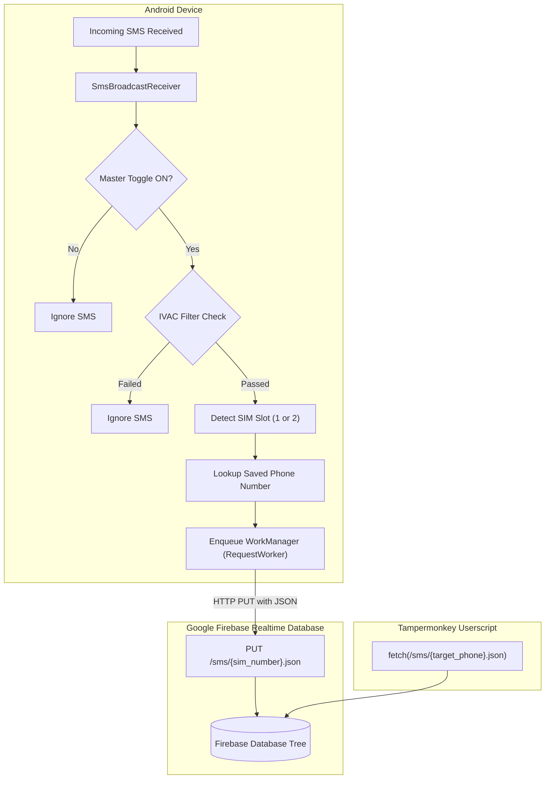
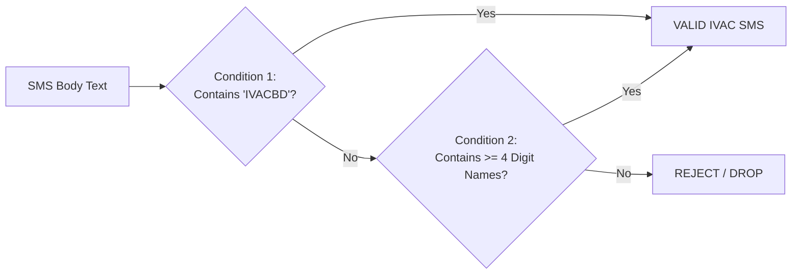

# IVAC SMS Gateway & Firebase Integration — Architecture Document

## 1. Overview & Objective

This project is a dedicated, hardened, and standalone **IVAC (Indian Visa Application Center) SMS Gateway** Android application.

The application operates as a background gateway that:

1. Listens for incoming SMS messages on the Android device.
2. Identifies whether an incoming message belongs to IVAC using a resilient multi-condition body text filter.
3. Automatically identifies which SIM card (SIM 1 or SIM 2) received the SMS.
4. Dynamically dispatches the raw IVAC SMS to Google Firebase Realtime Database via a direct REST `PUT` request, categorized by the respective SIM phone number.

```
+---------------------------------------------------------------------------------------+
|                                      DATA FLOW                                        |
+---------------------------------------------------------------------------------------+

   [ Incoming SMS ]
          │
          ▼
   [ SmsBroadcastReceiver ] ───────► [ IVAC Filter Engine ]
                                               │
                                      (Passes Filter?)
                                      ├── No  ──► [ Ignore / Drop ]
                                      └── Yes ──► [ Map SIM 1/2 to Phone Number ]
                                                         │
                                                         ▼
                                            [ Construct Dynamic URL ]
                                      PUT /sms/{target_phone_number}.json
                                                         │
                                                         ▼
                                            [ HTTP Worker / Network ]
                                                         │
                                                         ▼
                                          [ Firebase Realtime Database ]
                                                         │
                                                         ▼
                                            [ External Userscript ]
                                         (GET /sms/{phone_number}.json)
```

---

## 2. Core Architecture Components



---

## 3. App-Level IVAC Filtering Engine

To prevent dependency on mobile network sender masks (which change across telecom operators), filtering is done purely on the **SMS body text**.

### Filtering Criteria

An incoming SMS is accepted if it passes **either** of the following two independent conditions:



### 1. Condition 1: Keyword Check

- **Pattern:** `(?i).*ivacbd.*`
- **Behavior:** Case-insensitive match for the string `IVACBD`.

### 2. Condition 2: Word-Number Density Check (Future-Proofing)

IVAC OTPs are written as words rather than digits (e.g. `Six_One_Four_One_Seven_Two` or `Zero-One-Zero-Zero-Eight-Two`). Even if IVAC changes delimiters, formatting, or removes the prefix, this condition guarantees detection.

- **Word Dictionary:** `zero`, `one`, `two`, `three`, `four`, `five`, `six`, `seven`, `eight`, `nine`
- **Threshold:** The message must contain **at least 4 occurrences** of these words with word-boundary (`\b`) isolation.
- **False-Positive Prevention:** Normal personal text messages rarely contain 4+ spelled-out numbers, ensuring non-IVAC SMS are not forwarded.

---

## 4. Firebase Realtime Database REST API Contract

### Dynamic Endpoint Pattern

- **Live Database Base URL:** `https://ivac-gateway-default-rtdb.asia-southeast1.firebasedatabase.app/sms/`
- **Dynamic Target URL (Timestamp Keyed):**
  $$\text{Target URL} = \text{Base URL} + \text{Target SIM Number} + \text{"/"} + \text{timestamp} + \text{".json"}$$

Example:
$$\text{PUT } \texttt{https://ivac-gateway-default-rtdb.asia-southeast1.firebasedatabase.app/sms/01711111111/1711234567890.json}$$

> [!NOTE]
> Storing under `/{timestamp}.json` preserves a history of the last few SMS messages per SIM card rather than immediately overwriting. This enables auditing, debugging, and verification if multiple OTPs are requested.

### JSON Payload Specification

```json
{
  "sender": "IVACBD",
  "text": "(IVACBD) For security, type the following sequence when prompted Six_One_Four_One_Seven_Two .",
  "sim_slot": "SIM 1",
  "sim_number": "017XXXXXXXX",
  "timestamp": 1711234567890
}
```

### Database Representation (Multi-SMS History per SIM)

```json
{
  "sms": {
    "01711111111": {
      "1711234500000": {
        "sender": "IVACBD",
        "text": "(IVACBD) For security, type the following sequence when prompted Two_Zero_Five_Nine_One_Three .",
        "sim_slot": "SIM 1",
        "sim_number": "01711111111",
        "timestamp": 1711234500000
      },
      "1711234567890": {
        "sender": "IVACBD",
        "text": "(IVACBD) For security, type the following sequence when prompted Six_One_Four_One_Seven_Two .",
        "sim_slot": "SIM 1",
        "sim_number": "01711111111",
        "timestamp": 1711234567890
      }
    }
  }
}
```

### Race Condition & Stale SMS Prevention (Polling Protocol)

When the userscript initiates an OTP request on the IVAC portal and begins polling, an older SMS might already exist in the database. To prevent picking up old/stale OTPs, the system uses **Timestamp Verification**:

1. **Trigger Time Record:** When the user/script clicks "Send OTP" or triggers the request, note the exact epoch time:
   ```javascript
   const otpRequestTime = Date.now();
   ```
2. **Polling Filter:** During each poll (`GET /sms/{phone_number}.json`), filter out any message whose timestamp is older than `otpRequestTime - 5000` (5-second clock skew tolerance):

   ```javascript
   // Polling loop
   const response = await fetch(
     `https://ivac-gateway-default-rtdb.asia-southeast1.firebasedatabase.app/sms/${targetPhone}.json`,
   );
   const allSmsMap = await response.json();

   if (allSmsMap) {
     // Convert map to array and find the latest fresh SMS
     const freshSmsList = Object.values(allSmsMap)
       .filter((item) => item.timestamp > otpRequestTime - 5000)
       .sort((a, b) => b.timestamp - a.timestamp);

     if (freshSmsList.length > 0) {
       const latestValidSms = freshSmsList[0];
       console.log("Verified Fresh OTP Received:", latestValidSms.text);
       // Proceed with OTP processing
     } else {
       console.log("No new SMS yet. Still waiting for phone forwarder...");
     }
   }
   ```

3. **Outcome:** Even if 10 older SMS exist in the database, the script will strictly ignore them and only accept an SMS generated after the current button click.

### Data Retention & Auto-Deletion (TTL) Analysis

- **Firebase Realtime Database Native Limitation:** Unlike Cloud Firestore (which has a native TTL setting in the console), Firebase Realtime Database does **NOT** provide a native 1-click TTL auto-delete toggle directly inside its console dashboard.
- **Auto-Cleanup Strategies:**
  1. **Option A: Script-Level Auto-Purge:** Once the script successfully reads and consumes the OTP, it issues an HTTP `DELETE` for that specific record or resets the node.
  2. **Option B: Daily Auto-Cleanup via Scheduled Cron/Script:** A scheduled script or cron job running once a day makes a single `DELETE` call to `/sms.json` to purge yesterday's expired OTPs completely at zero cost.
  3. **Option C: App-Level Pruning:** When sending a new SMS, the Android app can query and prune nodes older than 24 hours.

---

## 5. UI/UX Redesign Specifications

All previous complex configuration menus, rule lists, template placeholders, and URL entry forms will be replaced by a streamlined, dedicated control panel:

```
+-------------------------------------------------------+
|                  IVAC SMS GATEWAY                     |
+-------------------------------------------------------+
|  [ Forwarding Status: ACTIVE ]                        |
|  Master Toggle: [ (●) ON ]                            |
+-------------------------------------------------------+
|  SIM 1 CONFIGURATION                                  |
|  Phone Number: [ 01711111111                        ] |
+-------------------------------------------------------+
|  SIM 2 CONFIGURATION                                  |
|  Phone Number: [ 01822222222                        ] |
+-------------------------------------------------------+
|  [  AUTO DETECT SIMS  ]     [  SAVE NUMBERS  ]        |
+-------------------------------------------------------+
|  Logs / Activity Status:                              |
|  ● Listening on SIM 1 & SIM 2                         |
|  ● Target: Firebase Realtime Database                 |
+-------------------------------------------------------+
```

### Key UI Features

1. **Master Forwarding Switch:** Single toggle controlling whether `SmsBroadcastReceiver` forwards or drops SMS.
2. **SIM 1 & SIM 2 Fields:**
   - Text inputs pre-populated with saved numbers.
   - Fully editable for manual override.
3. **"Auto Detect SIMs" Button:**
   - Uses Android `SubscriptionManager` (`READ_PHONE_STATE` / `READ_PHONE_NUMBERS`) to detect active carrier subscriptions and populate numbers automatically.
4. **"Save Numbers" Button:**
   - Persists values in `SharedPreferences`.

---

## 6. Implementation Code Map

| Component              | Target File                                | Key Changes                                                                                                     |
| :--------------------- | :----------------------------------------- | :-------------------------------------------------------------------------------------------------------------- |
| **Constants & Config** | `AppConfig.java` / `ForwardingConfig.java` | Base Firebase URL, SharedPreferences keys (`KEY_SIM1_NUMBER`, `KEY_SIM2_NUMBER`, `KEY_FORWARDING_ENABLED`).     |
| **Filter Engine**      | `IvacFilter.java` (New or integrated)      | `isIvacMessage(String text)` with Condition 1 (`ivacbd`) and Condition 2 (>= 4 word-numbers).                   |
| **Broadcast Receiver** | `SmsBroadcastReceiver.java`                | Intercepts SMS, calls `IvacFilter`, matches incoming SIM slot to saved phone number, dispatches to WorkManager. |
| **HTTP Dispatcher**    | `Request.java` / `RequestWorker.java`      | Configured to execute HTTP `PUT` with the dynamic Firebase URL and formatted JSON body.                         |
| **User Interface**     | `MainActivity.java` & `activity_main.xml`  | Redesigned layout with SIM 1/2 inputs, Auto Detect, Save, and Master Toggle.                                    |
| **Permissions**        | `AndroidManifest.xml`                      | `RECEIVE_SMS`, `READ_PHONE_STATE`, `READ_PHONE_NUMBERS`, `INTERNET`, `POST_NOTIFICATIONS`.                      |

---

## 7. Firebase Realtime Database Setup Guide (100% Free)

Follow these steps to generate your free Firebase database endpoint in under 3 minutes:

1. **Open Firebase Console:**
   - Navigate to [https://console.firebase.google.com/](https://console.firebase.google.com/) and sign in with your Google account.
2. **Create a Project:**
   - Click **"Add project"** (or **"Create a project"**).
   - Enter a project name (e.g. `ivac-sms-gateway`).
   - Disable Google Analytics (optional, not needed for personal utility).
   - Click **Create project**.
3. **Initialize Realtime Database:**
   - From the left navigation pane, go to **Build ➔ Realtime Database**.
   - Click **Create Database**.
   - Select a location (e.g. `Singapore (asia-southeast1)` for lowest latency in Bangladesh/South Asia, or `United States (us-central1)`).
   - Click **Next**.
4. **Configure Security Rules:**
   - Choose **"Start in test mode"** and click **Enable**.
   - Go to the **"Rules"** tab and update the rules to permit read/write for your app and script:
     ```json
     {
       "rules": {
         ".read": true,
         ".write": true
       }
     }
     ```
   - Click **Publish**.
5. **Obtain Database URL:**
   - Switch to the **"Data"** tab.
   - At the top of the panel, you will see your database URL:
     `https://your-project-id-default-rtdb.firebaseio.com/` (or `.asia-southeast1.firebasedatabase.app/`)
   - Copy this URL — this is the base URL configured in the Android app.
